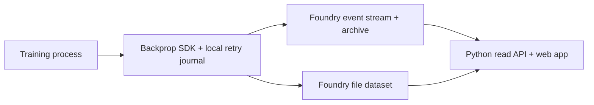

# Backprop

Backprop brings W&B-style experiment tracking to Palantir Foundry.

It provides a familiar Python API for experiment logging, distributed training,
artifacts and experiment inspection. Your data stays in Foundry, which handles storage,
hosting, authentication and permissions. Backprop is independent of Weights & Biases and
Palantir.


Compare runs and follow their metrics in the workspace.

<details>
<summary>Explore the runs table and a single experiment</summary>

**Runs table.** Browse experiments and compare their latest results.


**Run details.** Inspect an experiment's charts, configuration, logs, files and
artifacts from one view.


</details>

## Quick Start

Requires Python 3.10 or newer. Install Backprop 0.1.0 in the environment that runs your
training code:

```bash
python -m pip install 'backprop-foundry @ git+https://github.com/tginart/backprop.git@v0.1.0'
```

The Python package contains the SDK. Deploying the browser app requires a source
checkout:

```bash
git clone --branch v0.1.0 https://github.com/tginart/backprop.git
cd backprop
```

Follow the [setup guide](docs/foundry-setup.md) to deploy Backprop in your Foundry
enrollment. Download the connection file from the app's setup page or use the generated
`backend/state.json`:

```bash
export BACKPROP_CONFIG=/path/to/backprop-config.json
```

Supply a Foundry token through `FOUNDRY_TOKEN` or `BACKPROP_TOKEN`, or call
`backprop.login()` to save one locally. The package name is `backprop-foundry`; the
Python import is `backprop`.

```python
import backprop as wandb

with wandb.init(project="my-experiment", config={"lr": 1e-4}) as run:
    run.define_metric("tokens", hidden=True)
    run.define_metric("train/*", step_metric="tokens")

    for step in range(100):
        run.log({"tokens": step * 1024, "train/loss": 1 / (step + 1)})

    run.log({"examples": wandb.Table(
        columns=["input", "prediction"], data=[["hello", "world"]]
    )})
    run.summary["result"] = "complete"
    print(run.url)
```

Open the printed URL to inspect the run. Charts are created automatically from logged
metrics; tables, media and artifacts appear alongside them.

Offline logging needs no Foundry account:

```python
import backprop

with backprop.init(project="demo", mode="offline") as run:
    run.log({"loss": 0.5})
```

For runnable comparisons, artifact pipelines, shared writers and training telemetry, see
the [examples guide](examples/README.md).

To keep existing `import wandb` statements, run your training program through the
compatibility launcher:

```bash
python -m backprop run -- training.py [arguments]
python -m backprop run -- -m your_training_module [arguments]
```

The launcher redirects W&B imports within that Python process. Setting the official
SDK's `WANDB_BASE_URL` to Backprop will not work: compatibility is at the Python API
level.

Frameworks and media formats use **optional dependency groups**, called extras. The base
install stays small; an extra installs the libraries needed for a particular capability.
From a source checkout, for example:

```bash
python -m pip install '.[media,plots]'
```

| Extra | What it adds |
| --- | --- |
| `media` | NumPy and Pillow for image/array inputs. |
| `video` | Array-to-video encoding and its supporting libraries. |
| `plots` | Plotly, Matplotlib and statistical plotting dependencies. |
| `dataframes` | pandas, Polars and Arrow for dataframe inputs and exports. |

Extras such as `torch`, `tensorboard` and `lightning` add their respective framework
integrations. Packages are never installed automatically when a feature is used. See
[`pyproject.toml`](pyproject.toml) for all groups and the [authentication
guide](docs/python-api-support.md#authentication) for credential settings. Each
framework has its own Python requirements. Legacy fastai 1 has known dependency security
limits; see [dependency security](docs/dependency-security.md).

## How it Runs on Foundry

An installation uses a hosted static website, a streaming dataset for experiment events
and a file dataset for media and artifacts. Training processes write directly to
Foundry. There is no separate application server or database to run. The SDK uploads
every five seconds by default, and the browser refreshes every 30 seconds.



The SDK records run changes as events and keeps a durable local journal for retries and
offline logging. The Python read API and browser reconstruct runs from recent stream
events and archived history, applying the same ordering and deduplication rules.
Configuration, summary and descriptive artifact edits are new events; artifact contents
remain immutable.

Media and artifact snapshots live in the file dataset. External artifact references keep
their bytes at the original provider; `add_file` stores a snapshot in Foundry.

Experiment projects are namespaces within an installation and share its dataset
permissions. Reads currently reconstruct runs from events, so very large fleets would
need additional indexing. The [setup guide](docs/foundry-setup.md) covers resource
permissions, and [distributed logging](docs/distributed-logging.md) explains
shared-writer behavior.

Use the runs sidebar to choose which experiments appear on charts. Expand the runs table
to filter, group and sort runs, or open a run to inspect its Charts, Overview, Logs,
Files and Artifacts. Browsing choices are remembered locally. Custom panels, layout
editing and named/shared workspaces are not available in 0.1.0; the [interface
guide](docs/interface.md) describes current behavior.

### Installation settings

Each installation supplies its own Foundry host, project, public OAuth client and
datasets. Start with the tracked configuration template:

```bash
cp deploy/config.example.json deploy/config.local.json
```

Set `host` to your Foundry HTTPS origin and follow the [setup
guide](docs/foundry-setup.md) to create the resources. The configuration selects the
deployment and resource state files, with paths relative to the configuration file.
`deploy/config.local.json`, `deploy/state.json` and `backend/state.json` stay local and
are ignored by Git. The tracked `*.example.json` files contain placeholders.

Operator commands accept `--config PATH`, or use `BACKPROP_DEPLOY_CONFIG`. They read
`BACKPROP_TOKEN`, then `FOUNDRY_TOKEN`, then an optional Google Cloud Secret Manager
source configured locally. Google Cloud is required only for that last option. On
training machines, `BACKPROP_CONFIG` selects the resource connection file.

### Publishing updates

From a source checkout, replace `VERSION` with an unused website version for your
configured Foundry installation:

```bash
python deploy/deploy.py --config deploy/config.local.json --version VERSION
```

The script builds the website ZIP, waits for Foundry's asset scan, deploys the version
and verifies the deployed version. To build the same ZIP for manual upload without
credentials or API calls:

```bash
python deploy/deploy.py --config deploy/config.local.json --version VERSION --build-only backprop-site.zip
```

Keep the SDK wheel, source reference and website ZIP for each installed version. See
[updates and rollback](docs/updates.md) for SDK and browser update procedures.

## W&B Python SDK Compatibility

Backprop targets **`wandb==0.30.0`** for experiment logging, distributed logging,
artifacts and experiment inspection.

| Area | Supported APIs and behavior |
| --- | --- |
| Lifecycle and metrics | `init`, `log`, `finish`, `Config`, configuration and summary updates, `define_metric`, resume, offline logging, custom axes and summary aggregates. |
| Tables, media and charts | `Table`, `data_types.PartitionedTable`, `JoinedTable`, `EvalTable`, `Image`, `Audio`, `Video`, `Html`, `Histogram`, `Graph`, `Plotly`, `wandb.plot` helpers and locally registered custom charts. |
| Files, artifacts and models | `save`, `restore`, `Artifact`, `log_artifact`, `use_artifact`, `log_model`, `use_model`, immutable snapshots, editable metadata, tags and aliases. |
| Distributed logging and telemetry | `init(mode="shared")`, `run.upsert_artifact`, `run.finish_artifact`, `watch`, `unwatch`, PyTorch parameters/gradients/observed graphs and optional system metrics. |
| Inspection and edits | `Api`, public `Run` history/file/artifact reads, project/run creation, configuration and summary edits, and cooperative stopping. |
| Integrations | TensorBoard, Keras, Lightning Fabric, XGBoost, LightGBM, CatBoost, sklearn, fastai 1, SB3 and Gym/Gymnasium capture. |

The [API support guide](docs/python-api-support.md) describes supported APIs and
options. See [compatibility and migration](docs/compatibility.md) to adapt existing
code.

### Not supported

- **Experiment orchestration:** `sweep`, `agent`, `controller`, sweep inspection,
  Launch, jobs and run queues.
- **Hosted services and administration:** automations, alerts, Model Registry
  links, W&B identity/account administration, and deletion/retention APIs.
- **Specialized formats and other integrations:** `Object3D`, `box3d`, `Molecule`,
  `data_types.Bokeh`, `data_types.WBTraceTree` and framework adapters outside the
  selection above.
- **Separate products and service machinery:** Reports, Weave, Workspaces,
  W&B-hosted chart-specification IDs, and W&B server/background-service protocols.

The [support guide](docs/python-api-support.md#not-supported) lists the exact names.
Unsupported APIs and feature options raise `NotImplementedError`, also catchable as
`backprop.UnsupportedError`. Supported no-ops such as `mode="disabled"` retain their
documented behavior.

### Foundry differences

Foundry provides credentials, permissions, URLs and storage placement. `storage_region`
is unsupported. Artifact versions are content-based rather than sequential W&B version
numbers, and sampled history can differ from W&B.

Edits and shared-writer contributions become visible as events arrive; they do not
promise immediate cross-client consistency. Shared runs have a designated primary and
preserve each writer's local steps.

Multi-device GPU capture and some Plotly configurations are experimental. TensorBoard
imports do not support in-place event-file rewrites. See the [API support
guide](docs/python-api-support.md) for runtime requirements and limitations.

## Architectural Overview

The repository has three parts: the Python package, the browser app and the installation
tools. The package and browser read the same experiment events to reconstruct runs,
histories and artifact relationships.

| Component | Code | Responsibility |
| --- | --- | --- |
| Python entry points | [`__init__.py`](sdk/backprop/__init__.py), [`compatibility.py`](sdk/backprop/compatibility.py) | Run lifecycle, module-level helpers and the `wandb` import aliases used by the launcher. |
| Logging and persistence | [`run.py`](sdk/backprop/run.py), [`transport.py`](sdk/backprop/transport.py), [`foundry.py`](sdk/backprop/foundry.py) | A run records changes in a local journal; the transport publishes acknowledged batches and files to Foundry. |
| Values and adapters | [`media.py`](sdk/backprop/media.py), [`integration`](sdk/backprop/integration/__init__.py) | Tables, media, artifacts, plotting, training hooks and optional framework callbacks. These use the same run and journal rather than separate upload paths. |
| Experiment inspection | [`apis/public/api.py`](sdk/backprop/apis/public/api.py), [`replay.py`](sdk/backprop/apis/public/replay.py) | `Api` queries, returned run/file/artifact objects, event replay and public edits. |
| Browser app | [`web/app.mjs`](web/app.mjs), [`api.js`](web/api.js), [`model.mjs`](web/model.mjs) | Navigation and views, authenticated reads, and reconstruction of the run model. Chart, table and media viewers live in separate modules. |
| Installation tools | [`backend/provision.py`](backend/provision.py), [`deploy/deploy.py`](deploy/deploy.py) | Provision resources and package/publish the static app. These are operator tools, not a hosted Python backend. |

The [documentation index](docs/README.md) links the installation, migration and
interface guides. See [contributing](CONTRIBUTING.md) for local development and test
commands.

## Support and security

See [release notes](RELEASE_NOTES.md) for compatibility and limitations, [dependency
security](docs/dependency-security.md) for known dependency risks, and the [security
policy](SECURITY.md) to report a vulnerability.

Use [project issues](https://github.com/tginart/backprop/issues) for questions and bug
reports. Keep tokens, local deployment settings and private experiment data out of
reports and commits.

## License

Backprop is licensed under [Apache-2.0](LICENSE). See [NOTICE](NOTICE) and [third-party
notices](THIRD_PARTY_NOTICES.md) for bundled components and attribution.
