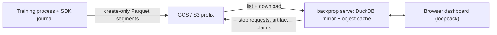

# Bucket backend (GCS or S3 with DuckDB)

Run Backprop on nothing but an object-store prefix. Training jobs write
immutable Parquet segments directly to `gs://` or `s3://`. Each viewer runs
`backprop serve gs://…/prefix`, which mirrors the prefix into a local DuckDB
database and serves the usual dashboard on a loopback port. There is no server
to deploy and no database to operate, and many writers and viewers can share one
prefix.

The public Python APIs, event schema, retry journal, and dashboard are shared with
the [Foundry](../foundry/README.md), [local SQLite](../local/README.md), and
[Google Cloud](../gcp/README.md) backends.

## How it runs



Every SDK flush writes one Parquet segment per run. A segment's key contains the
writer's UTC time and the SHA-256 of its records, so a retried batch writes the
same key, and the create-only write has no effect. Readers remove duplicate event
IDs. If two segments hold different content for the same event ID, the first
copy that a reader ingests wins, and the reader reports the conflict on stderr.

The viewer refreshes on a background thread (every 15 s by default). Active runs
list only the keys after a short lookback. Every run gets a full listing every
five minutes, which catches slow uploads and clock skew. New segments get
gap-free, permanent stream offsets in the mirror, so the dashboard's offset-based
live reads and history snapshots behave as they do on the local backend.

Stop requests go to their own prefix per training process
(`control/…/instance=<id>/`). A training process lists only that small prefix every
15 seconds, so stop delivery does not depend on any clock.

| Object | Responsibility |
| --- | --- |
| `_backprop/installation.json` | The installation ID, which namespaces journal acknowledgements. |
| `events/project=<p>/run_id=<r>/<time>-<sha256>.parquet` | Run events. |
| `control/project=<p>/run_id=<r>/instance=<i>/<time>-<sha256>.parquet` | Stop requests for one training process. |
| `files/blobs/<sha256>/<name>` | Content-addressed media and artifact bytes. |
| `files/artifact-resolutions/<key>.json` | First-writer-wins incremental artifact claims. |
| `~/.cache/backprop/bucket/<hash>/` | Each machine's object cache and the viewer's `mirror.duckdb`. |

## Installation and connection

```bash
python -m pip install 'backprop-foundry[bucket]'        # GCS
python -m pip install 'backprop-foundry[bucket,aws]'    # S3
```

Training jobs select the backend with environment variables or a connection file:

```bash
export BACKPROP_BACKEND=bucket
export BACKPROP_BUCKET_URI=gs://your-bucket/backprop
```

```json
{"backend": "bucket", "uri": "gs://your-bucket/backprop"}
```

View the data with:

```bash
backprop serve gs://your-bucket/backprop
```

The first writer or viewer creates `_backprop/installation.json`. The connection
can pin `bucket_id` to refuse a different installation at the same URI.

## Authentication and access

Backprop holds no credentials. GCS uses Application Default Credentials
(`gcloud auth application-default login`, a service account, or workload identity).
S3 uses the standard boto3 credential chain. Nothing is ever overwritten or deleted, so
writers and viewers need only these roles on the bucket or prefix:

- GCS: `roles/storage.objectCreator` and `roles/storage.objectViewer`.
- S3: `s3:PutObject`, `s3:GetObject` and `s3:ListBucket`.

## Operations

- `backprop serve URI --cache-dir DIR --refresh-s SECONDS` changes the mirror
  location and the refresh interval. Only one `serve` process can open a cache
  directory at a time.
- `backprop import URI JOURNALS…` imports offline journals into the bucket.
- The cache directory can be deleted at any time. The next start rebuilds it
  from the bucket.

## Limits

- Dashboard freshness is about the SDK flush interval (5 s) + `--refresh-s`
  + the dashboard's 30 s poll.
- Each SDK flush writes one small object per run, and an idle run writes one
  per heartbeat (30 s). Compaction is future work.
- Each refresh makes about 1 + projects + active runs list calls. A full
  sweep lists every run every five minutes.
- Project-wide SDK reads (for example artifact lookups) list the whole project.
  Reads without a project list the whole prefix.
- The dashboard labels the source "Local". "Connect your code" exports the
  viewer's loopback connection, which writes through the viewer. Use the direct
  bucket connection for training jobs.
- The S3 adapter is not tested. S3-compatible stores that ignore
  `If-None-Match` break first-writer-wins artifact claims.

## Code layout

| File | Responsibility |
| --- | --- |
| `config.py` | URI parsing, connection validation, cache location. |
| `objects.py` | GCS, S3 and `file://` adapters with create-only writes and retry-classified errors. |
| `segments.py` | Bucket layout, installation identity, Parquet encode and decode. |
| `cache.py` | Shared on-disk cache of immutable objects. |
| `mirror.py` | DuckDB mirror: incremental listing, dedupe, offsets, history queries. |
| `store.py` | SDK store and the per-process stop request reader. |
| `server.py` | `backprop serve` over the local dashboard HTTP handler. |
| `auth.py` | Credential-free connection selection. |
