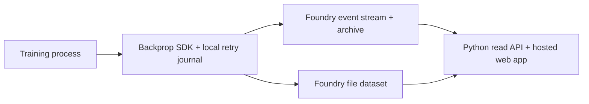

# Foundry backend

Run Backprop with Foundry Website Hosting, a streaming dataset for experiment
events, and a file dataset for media and artifacts. Training processes and the
dashboard use Foundry's APIs directly. The installation needs no separate
Backprop application server or database.

The public Python APIs, event schema, retry journal, and dashboard are shared with
the [local SQLite](../local/README.md) and [Google Cloud](../gcp/README.md) backends.

## How it runs



The SDK records run changes in a durable local journal and uploads batches every
five seconds by default. The browser refreshes every 30 seconds. Python readers
and the browser combine recent stream events with archived SQL history, then
apply the shared ordering and deduplication rules to reconstruct runs.

Configuration, summary, workspace, and descriptive artifact edits become new
events. Media and artifact snapshots live in the file dataset; their bytes remain
immutable. External artifact references keep their bytes at the original provider.
`add_file` stores a snapshot in Foundry.

Cooperative stop controls also use events. An authorized browser publishes a
request for one advertised process instance. That training process reads the
request and invokes its stop callback.

| Resource | Responsibility |
| --- | --- |
| Hosted static website | Serve the dashboard and public connection configuration. |
| Event stream and archive | Store run changes, live offsets, and queryable history. |
| File dataset | Store media, immutable artifact contents, and resolution records. |
| Local SDK journal | Retain retryable events and staged files on each training machine. |

## Installation and connection

Run operator commands from a source checkout. Start with the deployment template:

```bash
cp deploy/config.example.json deploy/config.local.json
```

Set the Foundry HTTPS origin and state-file paths. Follow the
[Foundry setup guide](../../docs/foundry-setup.md) to create the application,
register its public OAuth client, approve hosting, and provision the datasets.
The guide includes permissions, application restrictions, and CORS configuration.

Download the SDK connection file from the dashboard's setup page, or use the
generated resource state:

```bash
export BACKPROP_CONFIG=/absolute/path/to/backprop-config.json
python training.py
```

The connection selects the Foundry host, branch, datasets, and dashboard URL.
Connections without a `backend` field continue to select Foundry. Operator and
resource state files stay local; the tracked `*.example.json` files are templates.
See the [shared connection contract](../README.md).

## Authentication and access

Training machines use a Foundry bearer token from `BACKPROP_TOKEN`,
`FOUNDRY_TOKEN`, or the existing `backprop.login()` credential workflow. Browser
users sign in through the public OAuth client with authorization code and PKCE.
Client IDs and dataset RIDs are public configuration; bearer tokens and client
secrets do not belong in the website or connection file.

Foundry enforces the user's resource permissions and the application's allowed
operations. Browser reads need dataset/stream reads and SQL query access. Run
controls and workspace saves additionally require stream-write consent and
permission. An experiment project is a namespace within the installation, not an
independent dataset permission boundary.

Operator scripts read `BACKPROP_TOKEN`, then `FOUNDRY_TOKEN`, then an optional
Google Cloud Secret Manager source in the local deployment configuration. Google
Cloud is required only for that optional secret source.

## Publishing and operations

Use a new website version for the configured installation:

```bash
python deploy/deploy.py --config deploy/config.local.json --version VERSION
```

The script packages allowlisted website assets, waits for Foundry's asset scan,
deploys the version, and verifies it. For a credential-free ZIP build for manual
upload, use the same command with `--build-only backprop-site.zip`.

Keep the SDK wheel, source revision, and website ZIP for each installed version.
[Updates and rollback](../../docs/updates.md) covers compatible SDK/browser
updates. [Backend verification](../../docs/backend-verification.md) describes
acceptance checks against an existing installation.

Reads reconstruct runs from events. Event arrival and archive availability can
delay cross-client visibility. Review query volume and dataset access for large
fleets. [Distributed logging](../../docs/distributed-logging.md) describes shared
writers, primary ownership, and retry behavior.

## Code layout

- [`store.py`](store.py): Foundry HTTPS transport and file-transaction contention.
- [`credential_store.py`](credential_store.py), [`login_session.py`](login_session.py),
  and [`login_prompt.py`](login_prompt.py): SDK credential and login workflows.
- [`provision.py`](provision.py) and [`verify.py`](verify.py): resource setup and checks.
- [`web/backends/foundry.js`](../../web/backends/foundry.js): browser OAuth and policy.
- [`backend/README.md`](../README.md): shared interfaces and adapter ownership.
