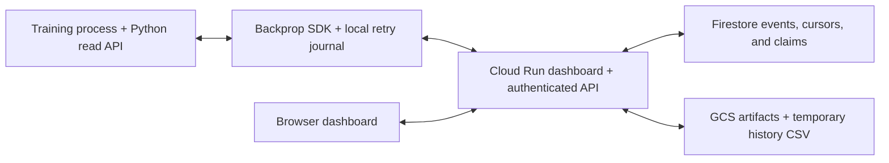

# Google Cloud backend

Run Backprop in your Google Cloud project with Cloud Run for the dashboard and
HTTP API, Firestore Native for events and metadata, and GCS for artifact bytes.
Each installation creates dedicated resources from explicit operator settings.

The public Python APIs, event schema, retry journal, and dashboard are shared with
the [Foundry](../foundry/README.md) and [local SQLite](../local/README.md) backends.

## How it runs



The SDK keeps its durable local journal and uploads batches every five seconds by
default. A Firestore transaction checks incoming event identities, creates new
records, and advances one of 16 partition cursors. Identical retries add no
records or offsets; conflicting identities reject the batch. Metrics ingestion
touches the incoming identities and cursor, independently of total stored history.

The browser refreshes every 30 seconds using record-offset pages. Live pages have
a 4 MiB JSON budget; clients continue from the last returned offset when a page
contains fewer records than requested. Python archive reads and initial browser
history use indexed Firestore queries at one fixed read time. The service streams
CSV results directly to GCS and retains their snapshot metadata for one hour.

GCS stores immutable media and artifact bytes. Firestore holds their references
and first-writer resolution claims. Bytes become durable before their reference
commits. Large files use 8 MiB upload parts, with the shared 512 MiB file limit.
Cooperative stops remain events consumed by the targeted training process.

| Resource | Responsibility |
| --- | --- |
| Cloud Run service | Serve public dashboard assets and authenticated data operations. |
| Named Firestore database | Store events, partition cursors, installation identity, file references, and claims. |
| Private GCS bucket | Store artifact bytes, upload parts, and temporary history exports. |
| Runtime service account | Access only the installation bucket and named database. |
| Artifact Registry repository | Store the installation's container images. |
| Local SDK journal | Retain retryable events and staged files on each training machine. |

## Installation and connection

Use a billed project with the required APIs and permissions already available.
From a source checkout, install the GCP dependencies and inspect prerequisites:

```bash
python -m pip install '.[gcp]'
python deploy/gcp_deploy.py --requirements
cp deploy/gcp.example.json deploy/gcp.local.json
```

Set the project, region, installation name, allowed Google emails, and browser
client ID in the local configuration. The
[Google Cloud setup guide](../../docs/gcp-setup.md) gives the one-time OAuth Web
client steps and lists exact IAM/API prerequisites. The deployment script creates
its own database, bucket, account, repository, and service; it does not adopt an
existing application's resources or infer a project from gcloud defaults.

```bash
python deploy/gcp_deploy.py --config deploy/gcp.local.json \
    --state .backprop/gcp/state.local.json
```

Register the returned canonical service origin on the Web client, then verify
browser sign-in. The script saves an SDK connection beside the resource ledger:

```bash
gcloud auth application-default login
export BACKPROP_CONFIG=/absolute/path/to/state.local.connection.json
python training.py
```

The public connection selects `"backend": "gcp"`, the HTTPS service origin, and
its stable `gcp_id`. Installation-scoped acknowledgement files prevent a journal
from reusing another backend's upload cursor. See the
[shared connection contract](../README.md).

## Authentication and access

The SDK uses refreshable Google Application Default Credentials. On Google
compute, use an attached service account whose email appears in `allowed_emails`.
Short-lived explicit Google tokens are also supported; those tokens do not
refresh themselves. Foundry credentials are not used for implicit GCP login.

The browser uses Google Identity Services with `openid email profile`. Register a
dedicated OAuth Web client and the exact returned JavaScript origin; this popup
flow needs no client secret or redirect URI. Every data API verifies the Google
identity and installation allowlist. The dashboard shell and connection file are
public. Experiment projects share the installation's access boundary.

## Deployment and operations

Cloud Run defaults to 1 CPU, 4 GiB memory, zero minimum instances, request
concurrency 16, and a 300-second timeout. Maximum instances default to four and
are configurable. Idle services can scale to zero. The server limits concurrent
API operations to four per instance while public assets bypass that gate.

The deployment ledger records resource ownership for cleanup:

```bash
python deploy/gcp_deploy.py --cleanup --state .backprop/gcp/state.local.json
```

Cleanup removes resources owned by that ledger, including its conditional
Firestore IAM grant. The separately registered OAuth client has its own lifecycle.
Operator config, credentials, and ledgers remain outside the public source.
API enablement remains an administrator prerequisite.

Firestore and GCS preserve data across Cloud Run revisions and scale-to-zero
events. Query snapshots expire after one hour; staged uploads and query bytes have
a one-day GCS lifecycle. Events and artifact bytes have no automatic retention or
general garbage collector. Load-test the intended writer, query, and artifact
workload. See [verification, limits, and cleanup](../../docs/gcp-setup.md#verify-and-clean-up)
for emulator coverage, shared acceptance tests, and live checks.

## Code layout

- [`server.py`](server.py): Cloud Run HTTP policy, admission control, and dashboard assets.
- [`database.py`](database.py) and [`queries.py`](queries.py): Firestore transactions, bounded live pages, and history queries.
- [`store.py`](store.py) and [`config.py`](config.py): SDK credentials, connection identity, and multipart uploads.
- [`auth.py`](auth.py): Google token verification and the installation allowlist.
- [`web/backends/gcp.js`](../../web/backends/gcp.js): browser Google sign-in and session policy.
- [`deploy/gcp_deploy.py`](../../deploy/gcp_deploy.py): resource creation and ownership-scoped cleanup.
- [`backend/README.md`](../README.md): shared interfaces and adapter ownership.
