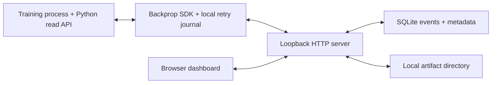

# Local SQLite backend

Run the dashboard and storage API on one machine. A loopback HTTP server serves
the installed dashboard, SQLite stores events and metadata, and a local artifact
directory stores immutable files. There is no cloud account or OAuth setup.

The public Python APIs, event schema, retry journal, and dashboard are shared with
the [Foundry](../foundry/README.md) and [Google Cloud](../gcp/README.md) backends.

## How it runs



The SDK writes a durable local journal and uploads batches every five seconds by
default. The server commits events and offsets in SQLite transactions. Identical
event retries consume no extra offsets; conflicting event identities reject the
batch. File bytes reach durable storage before their database reference commits.

Python readers use the scoped SQLite archive. The browser loads a fixed history
snapshot and follows later events through cursor pages, refreshing every 30
seconds. The server returns records and CSV query results over HTTP; the SQLite
database file stays on the data host. Configuration, summary, and artifact
metadata edits use the same shared event replay as the other backends.

Cooperative stop controls publish a request for one process instance. The training
process reads it and invokes its stop callback. Artifact APPEND claims preserve
the first successful resolution across writers and retries.

| Resource | Responsibility |
| --- | --- |
| Loopback HTTP server | Serve the dashboard and the shared data API. |
| `backprop.sqlite3` | Store events, offsets, file references, query snapshots, claims, and import cursors. |
| `artifacts/` | Store immutable media and artifact contents. |
| `connection.json` | Identify the loopback origin and stable installation. |
| Local SDK journal | Retain retryable events and staged files for each training run. |

## Installation and connection

From a source checkout, install and start the server:

```bash
python -m pip install .
backprop serve ./backprop-data
```

Open [the dashboard](http://127.0.0.1:8765). Wheels include its assets, so an
installed server needs no source checkout or Node.js. The default address is
`127.0.0.1:8765`; use `--port 9000`, `--port 0`, or IPv6 loopback `--host ::1`
when needed. Set the generated connection in the training environment:

```bash
export BACKPROP_CONFIG=/absolute/path/to/backprop-data/connection.json
python training.py
```

The connection selects `"backend": "local"` and a stable `local_id`. Restarting
against the same data directory preserves that identity, events, and offsets.
Journal acknowledgements and artifact caches remain scoped to that installation.
See the [shared connection contract](../README.md).

## Authentication and access

Local connections need no token or browser sign-in. The local adapter ignores
Foundry bearer tokens and bypasses system proxies. `backprop.login()` verifies the
local connection without a credential prompt or credential-file change.

The server accepts loopback addresses and checks browser origins. It provides no
multi-user access control or public TLS service. Experiment projects share the
same installation and files. For a server on a remote training machine, forward
its loopback port:

```bash
ssh -N -L 8765:127.0.0.1:8765 training-host
```

## Imports, backups, and operations

Import existing local journals through the same uploader:

```bash
backprop import ./backprop-data /path/to/wandb
```

Imports preserve source events, staged files, and original acknowledgement state.
Repeat an import to include new records. Bytes that exist only on a remote
provider must remain accessible through that provider; the importer uses locally
available files. [Local setup and imports](../../docs/local-backend.md) documents
offline branches, incomplete journals, and prefix-conflict behavior.

For backup, flush training writers, stop the server, and copy the complete data
directory, including the database, artifacts, and any remaining SQLite journal
files. Restore that directory and restart the server against it. Browser-local
preferences and SDK journals remain separate. See the
[backup procedure](../../docs/local-backend.md#backup-and-restore).

Use a local filesystem with reliable locks and fsync. The API implements the
Backprop contract with one stream partition and the `master` branch. Events keep
the 900 KB limit, files keep the 512 MiB limit, and the browser retains its
one-million-event limit. There is no automatic event retention or artifact garbage
collector. [Backend verification](../../docs/backend-verification.md) covers SDK,
installed-package, browser, restart, and durability checks.

## Code layout

- [`server.py`](server.py): loopback HTTP API and dashboard assets.
- [`database.py`](database.py) and [`queries.py`](queries.py): SQLite transactions and history snapshots.
- [`store.py`](store.py), [`config.py`](config.py), and [`auth.py`](auth.py): local connection and authentication policy.
- [`journal_import.py`](journal_import.py): read-only source journal import.
- [`web/backends/local.js`](../../web/backends/local.js): browser authentication policy.
- [`backend/README.md`](../README.md): shared interfaces and adapter ownership.
